<p align="center">
  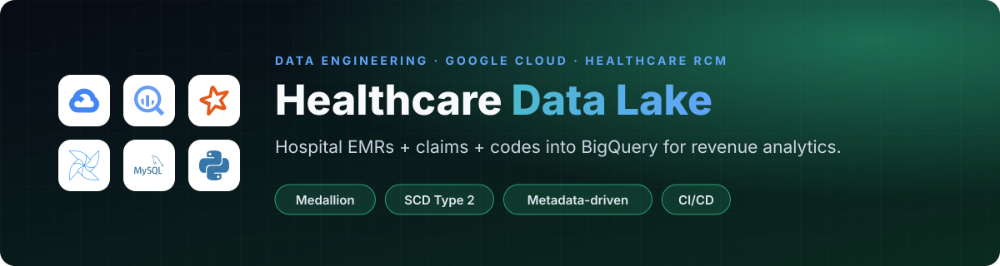
</p>

<p align="center">
  
  
  
  
  
  
</p>

<p align="center">
  <a href="#-overview">Overview</a> ·
  <a href="#%EF%B8%8F-architecture">Architecture</a> ·
  <a href="#-data-pipeline--workflow">Pipeline</a> ·
  <a href="#-deployment--cicd">CI/CD</a> ·
  <a href="#%EF%B8%8F-project-screenshots">Screenshots</a> ·
  <a href="#%EF%B8%8F-setup--installation">Setup</a>
</p>

---

> End-to-end **Healthcare Revenue Cycle Management (RCM)** Data Lake & Analytics on **Google Cloud Platform (GCP)**.

<table>
<tr>
<td width="50%" valign="top">

✅ Centralizes healthcare data from **EMRs, claims, CPT & NPI codes** into a unified data lake<br>
✅ Stores raw & processed data in **Google Cloud Storage (GCS)** 📦<br>
✅ Automates **ETL pipelines** with **Cloud Composer** ⏱️ & **Dataproc (Apache Spark)** 🔥<br>
✅ Implements **Medallion Architecture (Bronze → Silver → Gold)** 🪞 for structured, reliable data<br>
✅ Uses **SCD Type 2** 🕒 + **CDM (Common Data Model)** 📊 for historical tracking & standardization

</td>
<td width="50%" valign="top">

✅ Powers **BigQuery** 🗃️ for advanced analytics & KPI dashboards on revenue and claims<br>
✅ Leverages **Cloud SQL (MySQL)** 🗄️ for EMR transactional data<br>
✅ Ensures **CI/CD** ⚡ with **GitHub** 🐙 & **Cloud Build** 🔨 for seamless deployments<br>
✅ Provides **logging, monitoring & error handling** 📋 across all pipelines<br>
✅ Helps providers & insurers **reduce claim denials, improve revenue tracking, and streamline billing** 💰

</td>
</tr>
</table>

## 🌟 Overview

This project builds a scalable, maintainable **Data Lake** and **Analytics Platform** on **GCP** for **Revenue Cycle Management (RCM)** in Healthcare.

🎯 **Goal**: ingest, clean, transform, and analyze healthcare data (EMRs, claims, codes, etc.) so providers & insurers can:

- ✅ Streamline billing & claims processing
- ✅ Improve revenue tracking
- ✅ Enable data-driven decision making

## 🎯 Motivation

Healthcare data is scattered across **multiple silos** 🗂️: hospitals, insurers, coding systems. This project centralizes it to:

- 🚀 Enable **fast & error-free analytics**
- 📈 Provide **scalability** for growing data
- 🔍 Ensure **auditability & transparency**

## 🏗️ Architecture

<p align="center">
  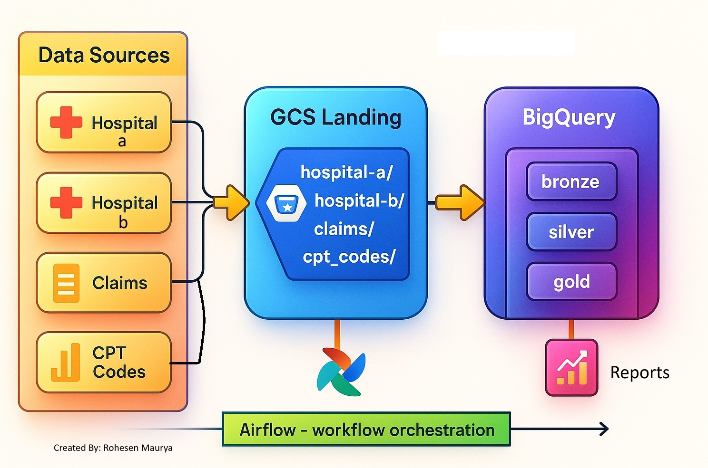
</p>

```text
 EMR MySQL (Hospitals)   Claims Files   CPT / NPI Data
         │                   │               │
         ▼                   ▼               ▼
      GCS (Raw Zone) ─→ Dataproc / Spark jobs → GCS (Processed Zone)
         │                            │
         ▼                            ▼
    Cloud Composer orchestration → BigQuery (Bronze / Silver / Gold tables)
         │
         ▼
     Dashboards / Reporting Layers / KPIs

CI/CD using GitHub + Cloud Build for deployments
Monitoring & Logging across all layers
```

## 📂 Data Sources

| Source | Description |
|---|---|
| 🏥 **EMR (Electronic Medical Records)** | From 2 hospitals |
| 📄 **Claims files** | Insurance claims data |
| 💉 **CPT codes** | Current Procedural Terminology |
| 🧾 **NPI data** | National Provider Identifier |

## 🛠️ Technologies & Tools

| Layer / Component | Technology / Service |
|---|---|
| Storage | **Google Cloud Storage (GCS)** 📦 |
| Data Warehouse | **BigQuery** 🗃️ |
| Processing Engine | **Dataproc (Apache Spark)** 🔥 |
| Orchestration | **Cloud Composer (Airflow)** ⏱️ |
| Transactional DB | **Cloud SQL (MySQL)** 🗄️ |
| Version Control | **GitHub** 🐙 |
| CI/CD Pipelines | **Cloud Build** ⚡ |
| Monitoring & Logging | **Cloud Logging / Stackdriver** 📊 |

## ✨ Key Features & Techniques

| | | |
|:--|:--|:--|
| 📐 **Metadata-Driven ETL** | 🕒 **SCD Type 2** for historical tracking | 📊 **CDM (Common Data Model)** |
| 🪞 **Medallion Architecture** (Bronze/Silver/Gold) | 🛡️ **Error Handling & Monitoring** | 🚦 **CI/CD Automation** for pipelines |
| ⚡ **Optimized Queries & Processing** | | |

## 🔄 Data Pipeline & Workflow

| Step | Stage | What happens |
|:-:|---|---|
| 1 | **Extraction** 📥 | Pull EMR data from Cloud SQL; ingest claims, CPT, NPI into GCS |
| 2 | **Transformation** 🔧 | Spark jobs clean & standardize data; apply metadata rules, SCD Type 2 |
| 3 | **Loading** 📤 | Store processed tables in BigQuery: Bronze → Silver → Gold (medallion model) |
| 4 | **Orchestration** 🧩 | Cloud Composer DAGs manage workflows |
| 5 | **Deployment** 🚀 | GitHub + Cloud Build handle CI/CD |

## ⚡ Deployment & CI/CD

Deployment in this project is fully automated using **CI/CD pipelines** to ensure reliable, version-controlled, and repeatable deployments.

**✅ Version Control with GitHub 🐙**
- All pipeline code, DAGs, and Spark jobs are managed in GitHub repositories.
- Branching strategy (feature branches → PRs → main branch).

**✅ Continuous Integration (CI) ⚙️**
- On every push or PR, code is linted and validated.
- Unit tests and integration tests ensure quality before merging.

**✅ Continuous Deployment (CD) 🚀**
- **Cloud Build 🔨** automatically deploys Airflow DAGs, Dataproc jobs, and BigQuery SQL scripts to GCP.
- Trigger-based deployments for different environments (dev, test, prod).

**✅ Automation Benefits 📈**
- Reduces manual intervention in deployments.
- Guarantees reproducibility and rollback if needed.
- Improves collaboration with faster feedback loops.

📸 *See the Cloud Build triggers & history in [Project Screenshots](#%EF%B8%8F-project-screenshots).*

## 📊 Expected Outcomes & Deliverables

- ⚡ **Automated pipelines** for RCM data
- 📂 **Gold tables** in BigQuery
- 📈 **KPIs**: revenue collection trends 💰 · claims processing efficiency ⏳ · rejection vs acceptance rates ✅❌
- 🖥️ **Dashboards** for hospitals & insurers

## 🖼️ Project Screenshots

| 📂 Google Cloud Storage (GCS) | 🗄️ Cloud SQL (MySQL) |
|:--:|:--:|
| 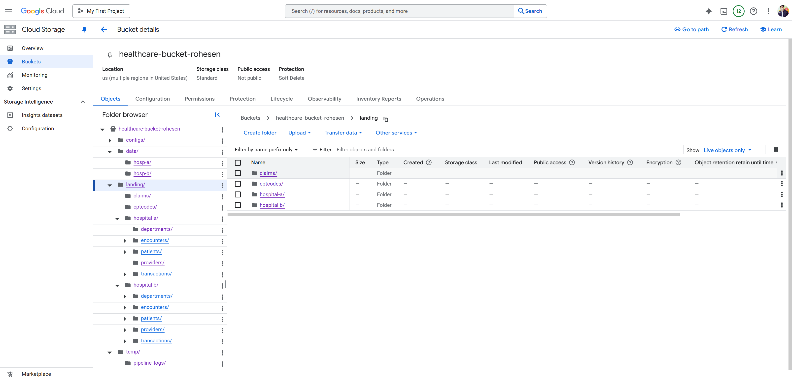 | 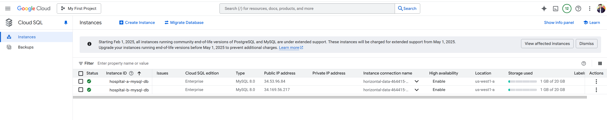 |
| **⚡ Dataproc Jobs** | **🗃️ BigQuery Datasets** |
| 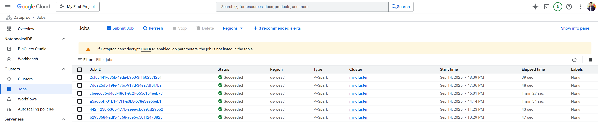 | 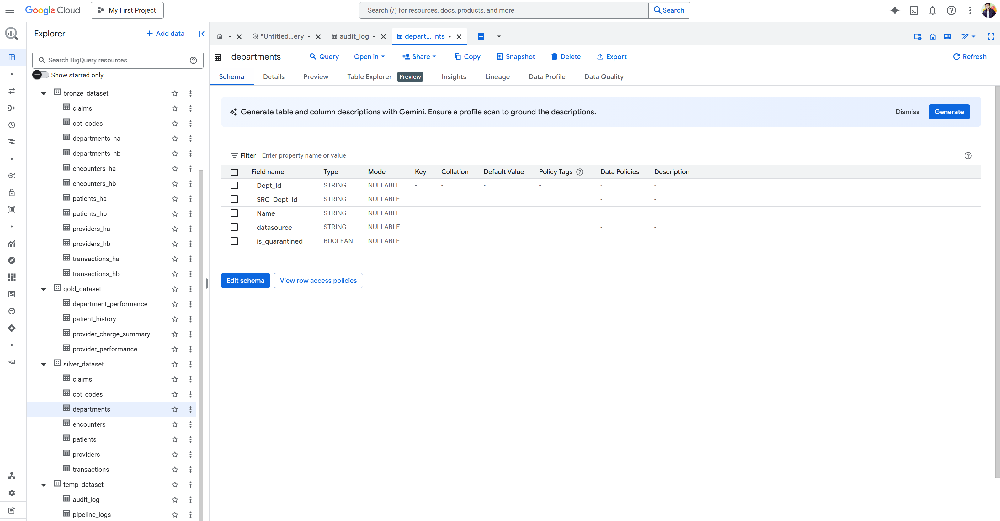 |

<details>
<summary><b>⏱️ Airflow DAGs (Composer)</b></summary>

<br>

**General DAGs view**
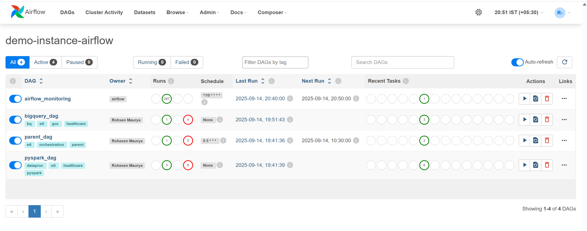

**PySpark DAG**
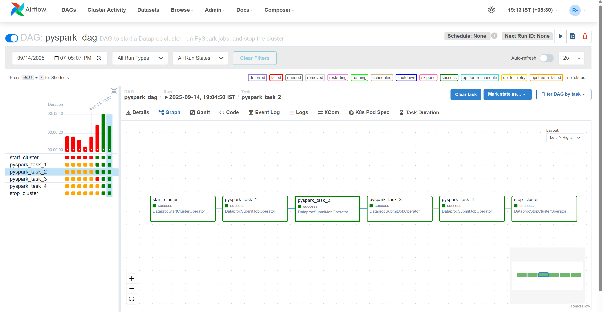

**BigQuery DAG**
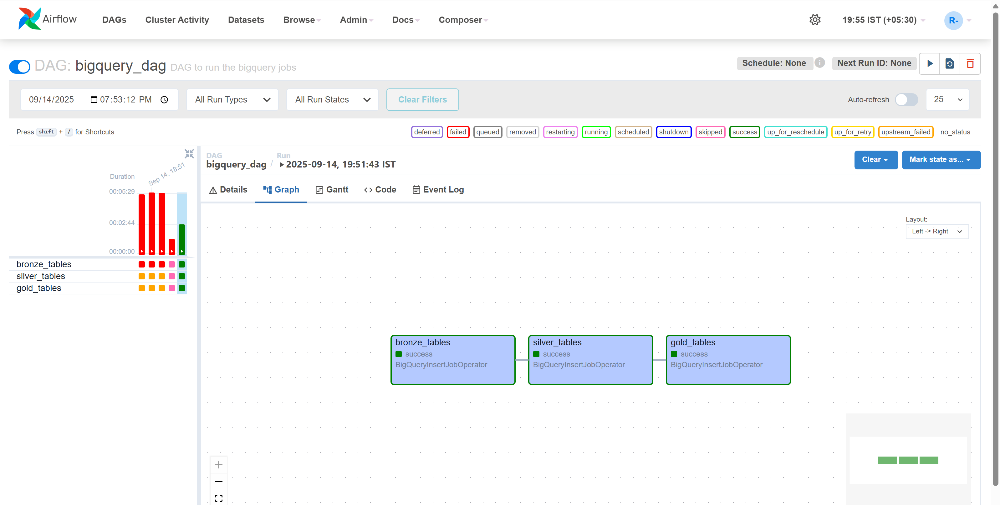

</details>

<details>
<summary><b>🔨 CI/CD (Cloud Build)</b></summary>

<br>

**Build Triggers**
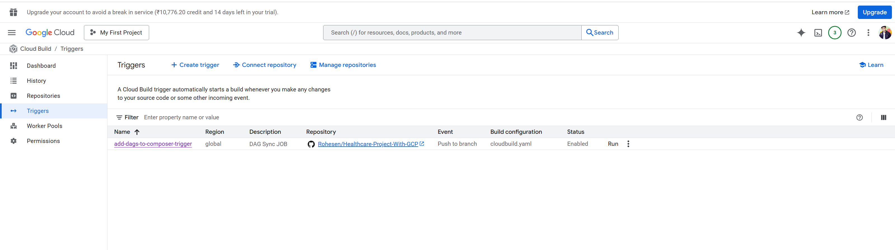

**Build History**
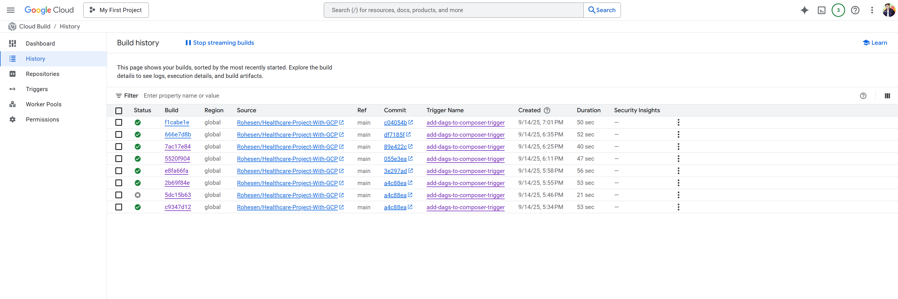

**Build Details & Trigger History**
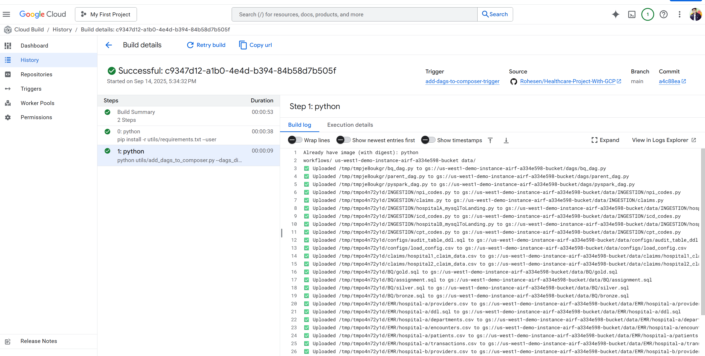

</details>

## ⚙️ Setup & Installation

**1. Clone the repo**

```bash
git clone https://github.com/Rohesen/Healthcare-Project-With-GCP.git
cd Healthcare-Project-With-GCP
```

**2. Configure the GCP environment** 🌐
- Create GCS buckets
- Provision Cloud SQL (MySQL)
- Set up BigQuery datasets

**3. Deploy pipelines** 🔄
- Spark jobs → Dataproc
- Airflow DAGs → Composer

**4. Set up CI/CD** ⚡
- Configure `cloudbuild.yaml`

## ▶️ Usage & Examples

- Run DAGs via the Airflow UI 🎛️
- Query BigQuery Gold tables for KPIs 📊
- Build dashboards with Looker Studio / Data Studio 📈

<details>
<summary><b>📋 Monitoring, Logging & Error Handling</b></summary>

- 📜 Centralized logs in Cloud Logging
- 🔔 Alerts for pipeline failures
- 🔁 Retry policies in Spark / Composer
- 🛡️ Error tables for failed records

</details>

<details>
<summary><b>🏆 Best Practices & Optimizations</b></summary>

- 🔍 BigQuery partitioning & clustering
- 📉 Minimize query scan costs
- ⚡ Spark tuning (optimize cores/memory)
- 🗂️ Metadata-driven schema definitions
- 📦 Versioned deployments

</details>

<details>
<summary><b>📚 Challenges & Lessons Learned</b></summary>

- Handling **schema drift** across datasets
- Ensuring **data quality** from varied sources
- Managing **cost vs performance trade-offs**
- Building robust **CI/CD pipelines** for data

</details>

## 🔮 Future Enhancements

- 🧩 Add new data sources (payer contracts, lab data, etc.)
- ⚡ Real-time ingestion with Pub/Sub / Dataflow
- 🤖 ML models for denial prediction, revenue forecasting
- 🔒 Data governance, lineage, masking for PHI/PII

## 🤝 Contributing

Contributions welcome! 🍴 Fork the repo → 🌿 create a feature branch → 💻 make changes + tests → 🔄 submit a PR.

## 📬 Contact

👤 **Author**: Rohesen<br>
🔗 **GitHub**: [Rohesen/Healthcare-Project-With-GCP](https://github.com/Rohesen/Healthcare-Project-With-GCP)<br>
📧 **Email**: [rohesen3u@gmail.com](mailto:rohesen3u@gmail.com)

<p align="center"><sub>If this project helped you, a ⭐ is appreciated</sub></p>
